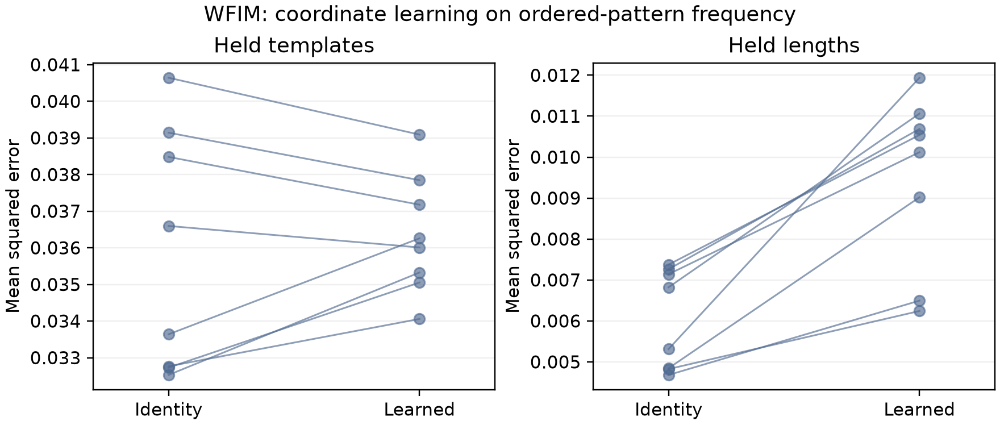

# Abstract

We study whether implemented structure produces measurable benefits after accounting for verification, strong controls, and failure cases. Nine related software modules cover optimization, adaptive memory, symmetry-guided search, program synthesis, word-algebra coordinates, constrained graph operators, weak dynamical discovery, conditional graph computation, and tool routing. Their scientific questions remain separate. We combine mechanism checks with bounded development experiments and retain failed runs. Several apparent advantages disappear under stronger controls: the learned optimizer has worse loss-area performance than tuned fixed optimizers; expert lifecycle does not outperform a simple stream predictor; learned symmetry proposals reduce expansions but increase elapsed time; and conditional graph routing is slower and less accurate than full refinement. A graph-operator constraint study exhibits a scoped error reduction, with adverse conditions retained. These results identify concrete mechanisms, computational tradeoffs, and unfinished tests rather than establish a universal architecture. The evidence is internally audited and includes exact same-host replays, but is not independently confirmed.

# 1. Introduction

A working implementation and a favorable benchmark number answer different questions. Structured algorithms may satisfy algebraic contracts yet add computational overhead, preserve valid paths without reducing search, or exploit a task construction that favors a particular representation. We investigate these distinctions in a shared research workbench. The central methodological question is whether a claimed mechanism survives comparisons that disclose information access, evaluation rules and measured work. Controls are not uniformly information- or cost-matched: physical priors and external pretraining differ in the cases identified below.

This retrospective report includes the nine namespaces already present in the workbench, with the named campaigns and failures enumerated in the claim index. It is not a systematic sample of structured-learning methods, and no completeness claim is made for unrecorded experiments. We do not pool incomparable endpoints or count random seeds as new datasets. Each module has its own model, domain, controls and limitations. The present contribution is a documented computational investigation; a claim of methodological novelty requires further comparison to the closest primary literature. This manuscript is a development report, not a statement that all proposed architectures or publication gates are complete.

# Related work and positioning

Learning an update rule is established prior work: Andrychowicz et al. (2016) train recurrent optimizers through optimization trajectories. QLearn's bounded controller is evaluated as a particular implementation, not as the invention of learned optimization. Celo2 (Moudgil et al., 2026) addresses learned-optimizer generalization and practical optimization; its released pretrained model supplies an external comparator here, with unmatched pretraining and unresolved data-overlap limitations.

Sparse identification of dynamics likewise predates this work. Brunton, Proctor and Kutz (2016) formulate discovery through sparse regression over candidate nonlinear terms. Messenger and Bortz (2020) develop weak-form identification to avoid pointwise derivative estimates and reduce sensitivity to noisy observations. WPINN's sequential observation-field and structured sparse-fit experiment belongs in that established context. Its contribution must be assessed through the additional structure and discriminating controls, not by renaming weak regression.

These citations establish background and attribution. They do not complete the closest-work review for all nine modules or establish novelty for this collection.

# 2. Experimental organization

All studies use bounded local CPU reference paths. Configurations, source identities, raw outputs and failures are retained in immutable campaign directories. Selection data choose hyperparameters or checkpoints; held observations are used for reporting. Tasks inspected during development are not subsequently described as secret holdouts. Most studies use eight seeds, but the independent population unit remains the dataset or generator family. Seed-level variability does not establish broad generalization.

We distinguish exact finite-domain contracts, numerical regression checks, development comparisons, and independent replication. Algebraic identities refer to the stated mathematical objects; floating-point implementations do not provide library-wide exact arithmetic. Seed-paired bootstrap intervals are exploratory and conditional on the fixed tasks; most comparisons are unadjusted and there is no collection-wide significance test. A certificate establishes only its explicit domain and assumptions. A successful program exit does not establish the scientific hypothesis. Failed required cells remain in denominators or make an aggregate unavailable; survivor-only means are not substituted. Exploratory interventions on a failed model are labeled retrospective rather than treated as new primary outcomes.

# 3. Mechanisms

## 3.1 Learned optimization and adaptive memory

QLearn produces bounded context-dependent updates and compares them with tuned SGD, momentum, AdamW, architecture ablations and the official pretrained Celo2 implementation. Its natural-data study uses binary digit-pair tasks, with distinct pairs for controller training, selection and held adaptation. The one dataset and unmatched external pretraining limit the interpretation. MALIS separately implements discrete action selection and rollback; its results are not evidence for the continuous controller.

QAPEN combines frozen learned quantization, continuous residuals, persistent expert identities, prospective activation, bounded replay, and delayed memory utility. Predictions precede observations. Checkpoint tests restore expert and optimizer state and reproduce continuation predictions. Single-expert memory and rolling predictors isolate whether retrieval or lifecycle management supplies any benefit.

## 3.2 Verified search and program synthesis

QWIPII searches finite token rings with rotations and adjacent swaps. A proposed map is eligible for fixed-goal pruning only after exhaustive verification of a complete multiset domain, bijectivity, preservation of the goal and every unit-cost transition. A map that transforms both board and goal can establish equivalence between problems without preserving the goal of a single search. Empty or incomplete samples cannot establish a certificate.

Serialized mappings are revalidated before use. Generator orbits are closed and search stores concrete representatives, so returned actions replay in the original coordinates. A trained ridge ranker predicts single-generator orbit reduction from public goal and sampled action features. Ranking does not authorize pruning; rejected proposals consume the verification budget. A separate greedy state ranker never merges approximate equivalence classes and does not guarantee shortest paths.

WCODE ranks a finite, typed program grammar using trained structural, token and task-conditioned controls. Candidate enumeration and available examples are held fixed. The benchmark measures verified completion in a finite DSL, not general software engineering. Shared semantic functions with earlier routing studies are explicitly disclosed.

## 3.3 Algebra, graph operators and physical discovery

WFIM uses word concatenation with degree truncation. Positive diagonal coordinates transport multiplication by applying the coordinate map, multiplying, and applying its inverse. Multiplicative per-letter scales cancel exactly; independent bounded per-word scales need not. Both products remain isomorphic to concatenation. An unrestricted decoder may absorb fixed diagonal feature reweighting, so downstream benefit must be established under stated optimization, regularization and storage constraints. A downstream coordinate study compares this mechanism to the identical fixed algebra and to vector, bilinear and binding controls.

WFT fits independent fine and coarse graph fields with equivariance and coarsening constraints. The actual teacher applies softplus to a constant-plus-cosine preactivation, not an exponential log-weight field; the older protocol wording is corrected here without changing its frozen data. The experiment uses explicitly verified equitable coarsening and distinguishes valid reflection constraints from deliberately invalid shifts. WPINN fits an observation-only neural field or spline and then performs sparse weak-form identification, with physical-structure constraints and derivative/weak baselines. Sequential fitting is part of the original first scope; joint physics training is optional and PDE extensions are deferred.

CWLNN selects nodes before expensive refinement. Router, local, coarse and refinement computations are measured rather than masking already computed outputs. Full refinement, flat networks and dense attention provide controls. Ultron routes among bounded capabilities and verifies outputs; the existing DSL results do not establish heterogeneous scientific orchestration or independent verification.

# 4. Results

## 4.1 Optimization and memory

At 32 adaptation steps, mean normalized loss area is 13.2809 for the full learned controller, 11.9562 for SGD, 7.9893 for momentum, 6.4145 for AdamW and 7.7454 for official pretrained Celo2; lower is better. These data do not support optimizer superiority. Wider tuning and longer meta-training retain failures and divergence instead of supplying complete favorable aggregates. Same-host replay of 400 original meta-training trials matches saved states and failure status.

The causal memory study contains 512 stream-method cells and 163,840 predictions. Mean negative log likelihood is 0.61727 for the candidate, 0.61225 for single-expert memory and 0.55893 for rolling ridge. Mechanism activation and checkpoint recovery therefore do not establish incremental lifecycle benefit. Broader delayed-cue, noise and cost-matched requirements remain open.

## 4.2 Search and synthesis

The learned QWIPII study uses five training goals of size three or four, three selection goals of size five, and four held goal patterns of size six. Eight seeds and four starts per held goal produce 128 cells per method and 896 total paths. All paths replay. Learned ordering averages 21.3047 expansions and 16.9859 ms per query, compared with 23.9453 expansions and 9.0092 ms for random ordering. Brute search averages 25.1719 expansions and 1.2703 ms. Query times include discovery and verification where used; training and selection costs are saved separately.

All non-greedy methods match brute shortest-path lengths. Greedy ranking returns longer paths in 16 of 128 cases. Removing the goal feature increases learned-search expansions; removing the sampled transition feature leaves the reported average unchanged. These are descriptive results within four fixed ring patterns, not new puzzle families. One timing observation per cell does not establish a hardware-general efficiency claim.

WCODE evaluates 331 canonical finite functions with 28,416 audited searches. Relational scoring at candidate cap 24 completes 10.54 percent of held-family cases, compared with 9.80 percent for token scoring. Held-composition completion is zero. Fifteen functions overlap older WCODE/Ultron data, including four current evaluation families. The evidence does not establish robust structural-ranking superiority.

## 4.3 Graphs and dynamics

WFT contains 160 learned fits, 64 fixed or oracle controls and 2,688 evaluation rows, of which 1,792 are transfer rows at previously unseen group counts 32 and 64. Both constraints yield mean error 0.000303878 versus 0.000928561 without either constraint within the declared generator. Across all evaluation sizes, both constraints are worse in 12 of 48 conditions; that denominator includes the training graph size and is not a transfer-only count. This is a bounded benefit, not a claim over arbitrary graph distributions. Numerical verification at nearly repeated spectral boundaries requires a disclosed gap-sensitive tolerance.

WPINN contains 120 condition cells, twelve methods, 240 learned observation fields and 6,720 replayed rollouts. Primary aggregates remain incomplete when required integrations fail: unconstrained neural weak fitting has 21 failed cells and the passive variant has three. Alternative stiff solvers complete four passive held trajectories but retain substantial prediction error. All 17 original failed polynomial rollouts remain preserved. Retrospective support interventions do not prove an exclusive failure cause.

CWLNN trains 128 models and reports 23,040 held predictions and 115,200 timing repeats. At half routing, learned routing has mean squared error 0.011939 versus 0.011412 for full hierarchy on the aligned task, and 0.032721 versus 0.029831 on diffusion. It is slower in both comparisons. Flat depth-five processing is strongest on the diffusion condition. Permutation audits agree to approximately 4.45e-16, supporting implementation consistency rather than routing benefit.

## 4.4 Learned word-algebra coordinates

The WFIM study trains 80 models across eight seeds, two fixed tasks and five encoders. All 40,640 saved predictions replay exactly after checkpoint reload. On ordered-pattern frequency, learned coordinates have held-template MSE 0.036352 versus 0.035816 for identity coordinates, and held-length MSE 0.009514 versus 0.006033. Mean training time is 9.75 versus 3.19 seconds. Thus the learned coordinates do not improve the primary task over the identical algebra. The order-insensitive count control is mixed. Encoders share a one-MiB payload cap and the same decoder/output dimensions, but use unequal bytes; this is not an exactly byte-matched capacity comparison.

{width=95%}

# 5. Discussion

Three recurring distinctions organize the observations; the experiments do not identify an exclusive causal explanation for every outcome. First, algebraic validity does not imply useful parameterization: per-letter transport cancels, and per-word transport remains an isomorphism. Second, less nominal work does not imply less elapsed work: exact proposal verification can dominate saved search expansions, and conditional routing can cost more than full refinement. Third, a mechanism-specific improvement does not establish the full architecture: retrieval can help while expert lifecycle loses to a simpler control.

These observations motivate finite branch decisions. The implemented per-letter product-expressivity claim is unsupported. Learned routing benefit is unsupported in the measured graph study. Learned proposal runtime benefit is unsupported in the ring study. The constrained graph-field result remains a scoped empirical benefit requiring broader comparisons and novelty review. None of these dispositions is converted into independent confirmation.

# 6. Limitations

The evidence includes small synthetic distributions, a single natural digit dataset, repeated seeds within fixed families, incomplete failure-affected aggregates and several unmatched total-cost components. Current finite rings do not cover whole new puzzle families. WFIM requires stronger byte-matched controls. Full selection replay now reconstructs all 80 models, 12,000 updates and 240 candidate checkpoint scores exactly; this closes replay bookkeeping, not the capacity-matching requirement. WPINN still needs held physical parameter regimes and inverse-PINN/data-only comparators. CWLNN arbitrary-tree receptive-field matching remains unresolved. Heterogeneous Ultron capability evaluation and independent external verification remain unfinished. These gaps prevent a submission-ready verdict for the full proposal collection.

# 7. Reproducibility

The repository retains campaign protocols, source hashes, selected checkpoints, predictions, failures and analysis receipts. The delivery builder includes campaigns and Git history and verifies archived contents before extraction. Fresh-environment checks have passed installation, tests and selected artifact audits after portability fixes. A subsequent isolated-source CWLNN audit using the existing separate review dependency environment now exactly reproduces 23,040 predictions and permutations, 256 checkpoint scores and one complete training replay. All 80 WFIM training histories and checkpoint selections also replay exactly. Same-host exact replays are useful diagnostics but do not establish independent reproduction. The delivery builder now includes the manuscript, generated figure and complete replay receipts; archive integrity and scientific readiness remain separate gates.

# 8. Conclusion

The workbench establishes several functioning mechanisms and documents where their claimed advantages fail under stronger controls or explicit cost accounting. Its present results justify scoped negative findings and further discriminating experiments. They do not establish a unified superior model, nine novel methods, or conference readiness. A useful final publication must make a coherent, evidence-supported contribution and preserve these limits.

# AI Use Statement

Codex was used extensively for implementation, experiment design, synthetic-data generators, mathematical analysis, testing, execution, result interpretation, literature search and manuscript drafting. Automated checks and same-host replay are described in the evidence record. Final human author review and responsibility have not yet been recorded; this development manuscript does not claim that such review has occurred.

# Evidence index

The reproducibility supplement consists of the source-bound protocols and result reports under `docs/closure`, the optimizer development record under `docs/execution/development-v2`, and their referenced immutable campaign directories. These are local artifacts, not public archival citations. Closest-work review, a complete scholarly bibliography and named human authorship/review remain required before submission. The figure and PDF are included for private review. Exact source, verification commands and limitations of this export are recorded in `FINAL_RELEASE_REPORT.md` and `docs/RELEASE_REPRODUCIBILITY.md`.

# References

Andrychowicz, M., Denil, M., Gomez, S., Hoffman, M. W., Pfau, D., Schaul, T., Shillingford, B., and de Freitas, N. (2016). Learning to learn by gradient descent by gradient descent. https://arxiv.org/abs/1606.04474.

Brunton, S. L., Proctor, J. L., and Kutz, J. N. (2016). Discovering governing equations from data by sparse identification of nonlinear dynamical systems. Proceedings of the National Academy of Sciences. https://doi.org/10.1073/pnas.1517384113.

Messenger, D. A., and Bortz, D. M. (2020). Weak SINDy: Galerkin-Based Data-Driven Model Selection. https://arxiv.org/abs/2005.04339.

Moudgil, A., Knyazev, B., and Belilovsky, E. (2026). Celo2: Towards Learned Optimization Free Lunch. https://arxiv.org/abs/2602.19142.
